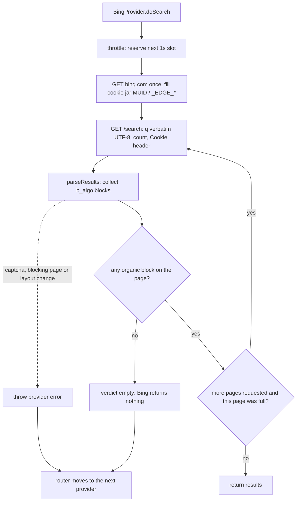

# Provider Fallback Flow

## BaseProvider — per-instance request queue

```mermaid
flowchart TD
    A[provider.search] --> B[save prev = this.requestQueue]
    B --> C[set this.requestQueue = new Promise(release)]
    C --> D[await prev]
    D --> E{health.is_healthy?}
    E -- No --> F[release, throw unhealthy]
    E -- Yes --> G[doSearch + recordSuccess / catch + recordError]
    G --> H[release]
    H --> I[return results / throw]
```

Multiple concurrent calls chain on the same promise — each waits for the previous `release()` before proceeding. This serialises `doSearch` per provider instance.

## searchParallel (per-slot fallback)

```mermaid
flowchart TD
    A[searchParallel] --> B[Init allResults=[], lastError=[], queue=[...providers]]
    B --> C[Start maxParallel slots via Promise.allSettled]

    C --> D[trySlot]
    D --> E{queue not empty?}
    E -- No --> F[Slot done - return]
    E -- Yes --> G[queue.shift -> provider]
    G --> H{healthCheck?}
    H -- unhealthy --> I[log warn, continue loop]
    I --> E
    H -- healthy --> J[provider.search  (goes through request queue)]
    J --> K{results > 0?}
    K -- Yes --> L[allResults.push, slot done - return]
    K -- No --> M[log warn empty, continue loop]
    M --> E
    J --> N[catch error -> lastError.push, continue loop]
    N --> E

    C --> O[All slots settled]
    O --> P{allResults.length > 0?}
    P -- Yes --> Q[Return allResults]
    P -- No --> R{lastError.length > 0?}
    R -- Yes --> S[Throw All providers failed]
    R -- No --> T[Throw No providers configured]
```

## searchSequential (unchanged, for comparison)

```mermaid
flowchart TD
    A[searchSequential] --> B[Iterate this.providers one by one]
    B --> C{healthCheck?}
    C -- unhealthy/skip --> D[continue to next provider]
    C -- healthy --> E[provider.search  (goes through request queue)]
    E --> F{results.length > 0?}
    F -- Yes --> G[Return results immediately]
    F -- No --> D
    D --> H{All providers exhausted?}
    H -- Yes --> I[Throw All sequential providers failed]
    H -- No --> C
```

## Bing scraped SERP — fetch flow



**No relevance judgement.** The SERP is checked only for being a SERP at all: HTTP status,
captcha/blocking page, and whether organic `b_algo` blocks exist. A text-overlap heuristic was tried and
removed — Bing's fallback page is structurally perfect and always carries a couple of query words, so any
word-match rule accepts junk, while distinctive-word rules rejected legitimate results. A badly answering
Bing is compensated by Startpage/DDG/Brave in the same merge, which is reranked anyway.

**Why scraping only, and where the Chrome channel went.** A headless-Chrome channel (query typed into the
search box over CDP) is kept on the `bing-browser-mode` branch instead of shipping. Measured 2026-11-04 on
the same machine and profile, one query per config:

| client | `Sec-CH-UA*` on the `/search` request | Bing answer |
|--------|----------------------------------------|-------------|
| honest headless UA (`HeadlessChrome/131`) | present | 10 relevant organic results |
| UA hidden via CDP `setUserAgentOverride` | **absent** (the override switches Client Hints off) | no results container at all, `ak_bmsc` bot cookie set |
| UA hidden via `--user-agent` flag (hints intact) | present | no results container at all |

So the deciding signal is not the `HeadlessChrome` token — it is the client claiming a desktop Chrome it does
not behave like. A parked channel is cheaper than a provider that spends 20 s timing out on a page that can
never satisfy the wait condition.

Why each step exists: Bing can answer bot traffic with a "degraded" SERP (200, a real result container,
no organic items) — that is the page the parked browser channel hits when the UA lies. The HTTP scraper
does not produce it: 16 never-asked cold queries on 2026-11-05, cookie-less and header-minimal, all came
back with 10 `b_algo` blocks. Forced `mkt=en-US&setlang=en-US&cc=US` returned identical junk for **every**
language, and `mkt=de-DE`/`ja-JP`/`zh-CN` returned literal "no results" pages, which is why the market
params are gone (2026-11-05) and the query goes out with nothing but `q`/`count`/`first`.
