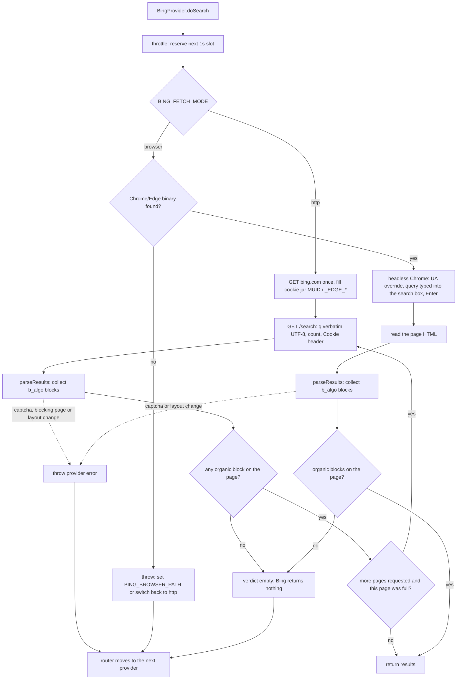

# Provider Fallback Flow

## BaseProvider — per-instance request queue

```mermaid
flowchart TD
    A[provider.search] --> B[save prev = this.requestQueue]
    B --> C[set this.requestQueue = new Promise(release)]
    C --> D[await prev]
    D --> E{health.is_healthy?}
    E -- No --> F[release, throw unhealthy]
    E -- Yes --> G[doSearch + recordSuccess / catch + recordError]
    G --> H[release]
    H --> I[return results / throw]
```

Multiple concurrent calls chain on the same promise — each waits for the previous `release()` before proceeding. This serialises `doSearch` per provider instance.

## searchParallel (per-slot fallback)

```mermaid
flowchart TD
    A[searchParallel] --> B[Init allResults=[], lastError=[], queue=[...providers]]
    B --> C[Start maxParallel slots via Promise.allSettled]

    C --> D[trySlot]
    D --> E{queue not empty?}
    E -- No --> F[Slot done - return]
    E -- Yes --> G[queue.shift -> provider]
    G --> H{healthCheck?}
    H -- unhealthy --> I[log warn, continue loop]
    I --> E
    H -- healthy --> J[provider.search  (goes through request queue)]
    J --> K{results > 0?}
    K -- Yes --> L[allResults.push, slot done - return]
    K -- No --> M[log warn empty, continue loop]
    M --> E
    J --> N[catch error -> lastError.push, continue loop]
    N --> E

    C --> O[All slots settled]
    O --> P{allResults.length > 0?}
    P -- Yes --> Q[Return allResults]
    P -- No --> R{lastError.length > 0?}
    R -- Yes --> S[Throw All providers failed]
    R -- No --> T[Throw No providers configured]
```

## searchSequential (unchanged, for comparison)

```mermaid
flowchart TD
    A[searchSequential] --> B[Iterate this.providers one by one]
    B --> C{healthCheck?}
    C -- unhealthy/skip --> D[continue to next provider]
    C -- healthy --> E[provider.search  (goes through request queue)]
    E --> F{results.length > 0?}
    F -- Yes --> G[Return results immediately]
    F -- No --> D
    D --> H{All providers exhausted?}
    H -- Yes --> I[Throw All sequential providers failed]
    H -- No --> C
```

## Bing scraped SERP — two independent fetch channels



**No relevance judgement.** The SERP is checked only for being a SERP at all: HTTP status,
captcha/blocking page, and whether organic `b_algo` blocks exist. A text-overlap heuristic was tried and
removed — Bing's fallback page is structurally perfect and always carries a couple of query words, so any
word-match rule accepts junk, while distinctive-word rules rejected legitimate results. A badly answering
Bing is compensated by Startpage/DDG/Brave in the same merge, which is reranked anyway.

**Why two channels instead of a chain.** Switching channel per query made behaviour unpredictable (the
same query took a different path depending on one heuristic). `http` and `browser` are now separate
implementations selected in config; the first-run `.env` writes `browser` when a Chrome/Edge is installed
on that machine, `http` otherwise.

**Why the browser channel exists.** Live experiments showed the trigger for Bing's fallback page is the
`HeadlessChrome` UA token plus the absence of a real form submit: with the token replaced and the query
typed into Bing's box, a headless Chrome returns the same live SERP as a visible window, while
`GET /search?q=` still returns the fallback. The browser runs detached from the user's profile (own
`--user-data-dir`), is reused across searches, serialised through a queue, and killed after
`BING_BROWSER_IDLE_MS`.

Why each step exists: cookie-less Bing answers bot traffic with a "degraded" SERP (200, a real result
container, no organic items); simultaneous hits from parallel tool calls trigger the same contentless
page; forced `mkt=en-US&setlang=en-US&cc=US` returned identical junk for **every** language, and
`mkt=de-DE`/`ja-JP`/`zh-CN` returned literal "no results" pages. So the query goes out verbatim, locale
is expressed only through `Accept-Language`, and market params are opt-in.
