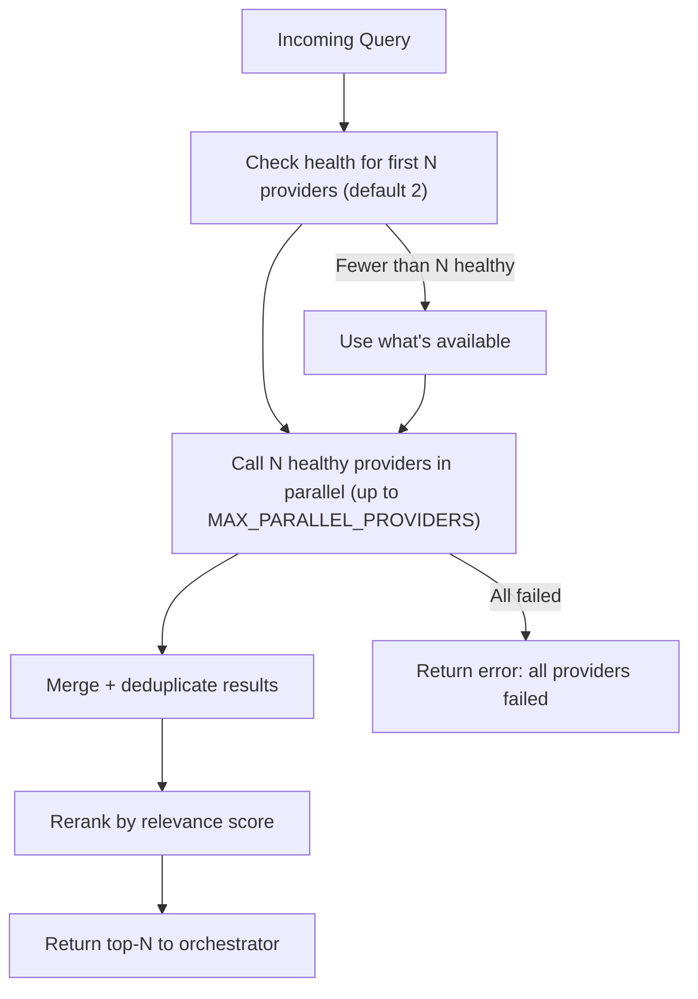

# Search Providers

## Overview

Providers work with the router, which selects the first 2 healthy providers and calls them in parallel. Results are aggregated, deduplicated, and reranked. If a provider is unavailable — fallback to the next ones.

## Tier 1 — Core (free, scraping)

### Startpage (Google Mirror)

| Parameter | Value |
|-----------|-------|
| Type | HTML scraping (Google results via proxy) |
| API | POST `startpage.com/sp/search` |
| Limits | Implicit (IP-based) |
| Key | Not required |
| Intents | web, docs, news |

**Features:**
- Free Google results without API key
- Uses `sc` code + preferences cookie for session
- Extracts date from snippet prefix: `Jan 27, 2026` or `27 Jan 2026`
- 1s delay between requests, incremental backoff on 429

> **⚠️ Undocumented limits.** Startpage does not publish scraping limits. May return captcha or empty results without clear reason.

**Configuration:**
```env
STARTPAGE_ENABLED=true
```

---

### DuckDuckGo

| Parameter | Value |
|-----------|-------|
| Type | HTML scraping |
| API | POST `html.duckduckgo.com/html/` |
| Limits | 10 req/min (IP-based) |
| Key | Not required |
| Intents | web, docs |

**Features:**
- Free, no registration
- 10 results per page, up to 1 page
- 1s delay between requests
- Rate limit with delay between requests

> **⚠️ Undocumented limits.** DDG frequently returns captcha when scraping. No official search API — HTML parsing only.

**Configuration:**
```env
DDG_ENABLED=true
DDG_DELAY_MS=1000
DDG_MAX_PER_MINUTE=10
```

---

### Brave Web

| Parameter | Value |
|-----------|-------|
| Type | HTML scraping |
| API | GET `search.brave.com/search` |
| Limits | Implicit (IP-based, 429 on burst) |
| Key | Not required |
| Intents | web, docs, news |

**Features:**
- Free, no registration
- 1s delay between requests
- 429/403 detection → incremental backoff suspension
- Cookies set: safesearch=off, useLocation=0, summarizer=0, country=us, ui_lang=en-us
- Retry-After header support if Brave starts sending it

> **⚠️ Undocumented limits.** Brave Search is not designed for scraping. Limits are not documented — may return 429 at any time. Brave API (official) is more stable but requires a key.

**Configuration:**
```env
BRAVE_WEB_ENABLED=true
```

---

### Bing

| Parameter | Value |
|-----------|-------|
| Type | HTML scraping / RSS feed |
| API | GET `bing.com/search` |
| Limits | Implicit (IP-based) |
| Key | Not required |
| Intents | web |

**Features:**
- Free, no registration
- Headers are constant and browser-like (`Chrome/131` UA, `Accept-Language: en-US,en;q=0.9`); deriving them from the query language or dropping them changes nothing
- No market params (`mkt`/`setlang`/`cc`). Upstream SearXNG replaced `mkt` with `setlang=` + `cc=` for this engine and skips `us|cn|ru` ("bing just sends junk for these"), but no combination of these parameters changes the result set from an IP that Bing has already associated with a market — see the Bing bullets in `docs/roadmap.md`
- No cookie session and no homepage warm-up request: cookie-less scraping gets the same SERP
- Two channels behind `BING_FETCH_MODE`: `html` (paged SERP, default) and `rss` (single request, ≤10 items, real destination URLs; `BING_RESULTS_PER_PAGE`/`BING_MAX_PAGES` do not apply)
- Parses `b_algo` blocks from HTML results page
- Different index from DDG — expands coverage
- 1s between requests via slot reservation, so parallel tool calls don't fire simultaneously (that burst is what triggers contentless SERPs)

> **⚠️ Undocumented limits.** Bing does not publish scraping limits and may return captcha under high request frequency. Quality is IP-, query- **and client**-dependent: for a multi-word string the plain-HTTP channel can return what the *first word* alone would return, while the same string submitted from a non-headless browser's search box comes back relevant — and stays warm on that IP for every later client, headless or not. No header, cookie or parameter changes this, so the provider cannot fix it on its own: Startpage/DDG stay in the chain and the merge is reranked. The measurements and the log names are in the 2026-11-06 bullets of `docs/roadmap.md`.

**HTML Channel:** paged scraping of `/search?q=` — the request carries `q`, `count` and `first` and nothing else, so there is no session state and no warm-up request.

**RSS channel (`BING_FETCH_MODE=rss`):** the same endpoint with `format=rss` returns an RSS 2.0 feed — one request, at most 10 items, no paging (`count` and `first` are ignored by the feed) — with the real destination URL in `<link>` instead of a `bing.com/ck/a` tracking wrapper, plus `title`, `description` and `pubDate`. Relevance is the same as the HTML channel — the feed does not fix the junk problem described. It is a cheaper structural channel, not a better one. Measurements behind these statements: `docs/roadmap.md`.

> **Parked: the headless-Chrome channel.** A second channel that typed the query into Bing's search box over CDP lives on the `bing-browser-mode` branch and is not shipped: hiding the `HeadlessChrome` token also drops Chrome's Client Hints, and Bing then answers with a page that has **no results container** at all. Headless Chrome, however it is driven, gets the degraded SERP for a query that has not been searched before and cannot warm Bing's own cache — only a submit from a non-headless Chrome's search box does. Details and the measurements behind this: `docs/roadmap.md`. The channel stays on the branch until that is solved.


**Response checks — structural only:**

| Situation | Handling |
|-----------|----------|
| HTTP status ≠ 200 | provider error → the router moves to the next provider |
| captcha / blocking page | provider error → Bing gets suspended per the rate-limit policy |
| no organic blocks (`b_no` notice, or a "degraded" page without `b_algo`) | empty result set → Bing steps aside, Startpage/DDG/Brave answer |
| a page carries fewer results than requested | pagination stops, earlier pages are kept |
| HTML layout changed (no `b_results`/`b_algo`/`b_no` at all) | provider error, so the change is visible instead of silent |
| RSS response is not XML (captcha/block page) | provider error → same suspension policy as any other block |
| RSS feed carries no `<item>` | empty result set → same handling as a `b_no` page |


**Configuration:**
```env
BING_ENABLED=true
BING_FETCH_MODE=html   # html | rss
```

Diagnostics: `npm run test:bing` prints every request and every fetched page with its verdict and latency; run `BING_FETCH_MODE=rss npm run test:bing` to check the feed channel — see [testing.md](testing.md).

---

## Tier 2 — Official APIs (free tier)

### Brave Search API

| Parameter | Value |
|-----------|-------|
| Type | Official REST API |
| Limits | 2000 requests/month (free) |
| Key | Required (free registration) |
| Intents | web, docs, news |

**Configuration:**
```env
BRAVE_API_KEY=BSA...
BRAVE_DAILY_LIMIT=60
```

---

### Tavily API

| Parameter | Value |
|-----------|-------|
| Type | AI-oriented search |
| Limits | 1000 requests/month (free) |
| Key | Required (free registration) |
| Intents | web, docs |

**Features:**
- Built specifically for AI agents
- Returns `content` (extracted text) out of the box
- Works well for docs intent
- Endpoint is configurable: `TAVILY_BASE_URL` routes the call through a proxy when the stock host is blocked

**Configuration:**
```env
TAVILY_API_KEY=tvly-...
TAVILY_DAILY_LIMIT=30
TAVILY_BASE_URL=https://api.tavily.com
```

**Endpoint override:** `TAVILY_BASE_URL` is the origin of the API or of a proxy in front of it. `/search` is appended automatically, so `https://proxy.example.com` and `https://proxy.example.com/search` both work; a trailing slash is ignored and an empty value falls back to `https://api.tavily.com`. The provider authenticates with `api_key` inside the JSON body (as before), so the proxy only has to forward the POST body — `npm run test:tavily` prints which endpoint was used and what came back. Use it when the stock origin is blocked or unreachable from your network: a proxy you run restores the call, and the credential stays on this side. A ready-to-deploy proxy is documented in [Tavily through a Cloudflare Worker](tavily-proxy-worker.md).

---

## Tier 3 — Optional

### Exa

| Parameter | Value |
|-----------|-------|
| Type | Semantic search |
| Limits | 1000 requests/month (free) |
| Key | Required |
| Intents | web, docs |
| Endpoint | `api.exa.ai/search`, overridable with `EXA_BASE_URL` |

```env
EXA_API_KEY=...
EXA_BASE_URL=https://api.exa.ai
```

**Endpoint override:** `EXA_BASE_URL` is the origin of the API or of a proxy in front of it. `/search` is appended automatically, so a proxy mounted under a path works too — `https://proxy.example.com/functions/v1/exa-api` and `https://proxy.example.com/functions/v1/exa-api/search` both resolve to the same call; a trailing slash is ignored and an empty value falls back to `https://api.exa.ai`. Unlike Tavily, Exa authenticates with the **`x-api-key` header**, so a relay has to forward headers as well as the JSON body. Use the override when `api.exa.ai` is blocked or unreachable from your network; `npm run test:exa` prints the resolved endpoint, the HTTP status and the results.

**What a relay must do:** accept `POST {base}/search` with `content-type: application/json`, pass the body and the `x-api-key` header through unchanged, and return Exa's own JSON. A ready-to-deploy proxy is documented in [Exa through a Supabase Edge Function](exa-proxy-edge-function.md).

**Snippets come from `contents.highlights`.** The provider asks for `{ contents: { highlights: true } }` and joins the passages Exa selected for each page, cutting the result to `EXA_SNIPPET_MAX_CHARS` = 600 characters (whitespace collapsed). For scale on a ~10-result query: an answer without `contents` is a couple of KB and carries **no text at all**, `contents.highlights` makes it a few tens of KB, and `contents.text` (full page text) makes it ~100 KB with individual pages in the tens of KB — after our 600-character cut the snippets total a few KB per search, which is why highlights are the default and full text is not asked for. Exa bills the three shapes the same: the base `/search` price covers the first 10 results **with** contents (their changelog: “Search with contents: $7 per 1k requests (10 results, text + highlights included)”); only results above 10 add $1 per 1k, and the separate `/contents` endpoint is $1 per 1k pages per content type. 

### Firecrawl

| Parameter | Value |
|-----------|-------|
| Type | Web scraping + search |
| Limits | 500 credits/month (free) |
| Key | Required |
| API | `api.firecrawl.dev/v2/search` |
| Intents | docs |

```env
FIRECRAWL_API_KEY=...
```

---

## Provider Router: selection algorithm



## Routing Strategy

**Parallel request to 2 providers:**
1. Find the first 2 healthy providers in order
2. Call them in parallel via `Promise.allSettled`
3. Aggregate results
4. Reranker deduplicates by normalized URL and sorts

**Default provider order:** Startpage → DDG → Brave Web → Bing → Brave API → Tavily → Exa → Firecrawl  
Custom order via `PROVIDER_ORDER` in `.env` (comma-separated names).

If one provider fails — results from the other are still returned (parallel mode). Sequential mode stops on first success.

## Health Tracking

Each provider tracks:

```typescript
interface ProviderHealth {
  consecutive_errors: number;
  last_success: Date | null;
  last_error: Date | null;
  avg_latency_ms: number;
  requests_today: number;
  is_healthy: boolean;
}
```

**Provider is unhealthy if:**
- `consecutive_errors >= 3`

**Recovery:** an unhealthy provider gets a trial attempt on the next cycle. If successful — it recovers.
