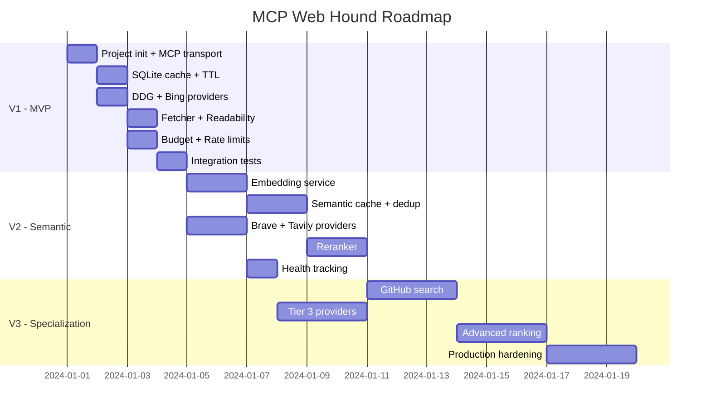

# Roadmap

## V1 — MVP (1–2 days)

Minimally working version with one provider and basic cache.

### Tasks

- [x] Project init (TypeScript, `@modelcontextprotocol/sdk`)
- [x] MCP transport (stdio, JSON-RPC)
- [x] Tool: `search` with zod validation
- [x] Tool: `status` with basic diagnostics
- [x] Query Normalizer (lowercase, trim, cache key)
- [x] SQLite cache (queries, results, pages)
- [x] TTL-based eviction
- [x] DuckDuckGo adapter (HTML scraping)
- [x] Sequential fallback (DDG → Bing)
- [x] Content Fetcher (HTTP GET → readability → markdown)
- [x] Budget Manager (search limit, fetch limit)
- [x] Rate limiting (per-provider)
- [x] Structured logging
- [x] `.env` configuration
- [x] Tests: unit for each module
- [x] Tests: integration smoke test

### V1 Result

Agent calls `web_search()` → first healthy provider responds → results cached.

---

## V2 — Semantic Layer + Tier 2 (3–5 days)

Semantic cache and official API providers.

### Tasks

- [x] Embedding service (multilingual-e5-small)
- [x] sqlite-vec integration
- [x] Semantic query cache (find similar, threshold 0.92)
- [x] Query deduplication (buffer last 50 queries)
- [x] Provider: Brave Search API adapter
- [x] Provider: Tavily API adapter
- [x] Reranker: semantic similarity scoring
- [x] Reranker: domain quality scoring
- [x] Reranker: freshness scoring
- [x] Reranker: position blending
- [x] Weighted final score
- [x] Intent-independent reranking weights
- [x] Deduplication by URL
- [x] Provider health tracking
- [x] Provider health recovery (5-min retry)
- [x] Extended `status()` (provider health, cache stats)
- [x] Tests: semantic cache
- [x] Tests: reranker scoring

### V2 Result

Agent gets deduplicated, ranked results. Similar queries don't waste budget. 4 providers with fallback.

---

## V3 — Specialization + Production (1–2 weeks)

Specialized search modes and production-ready hardening.

### Tasks

- [x] GitHub-specific search (GitHub API, repos/code/issues/users)
- [x] GitLab-specific search (GitLab API, projects/issues/MRs/blobs)
- [x] Docs-specific search — covered by `intent: "docs"` + reranker, separate tool not needed
- [x] Intent routing via NLI zero-shot (DeBERTa-v3-xsmall, 4 labels, softmax)
- [x] NLI-based reranking (intent-independent: 0.9 NLI + 0.04 domain + 0.03 freshness + 0.03 position)
- [ ] Advanced ranking: learning-to-rank based on agent feedback
- [ ] Provider health scoring (composite: latency + error rate + quality)
- [x] Provider: Exa adapter
- [x] Provider: Firecrawl adapter
- [x] Parallel multi-provider queries
- [x] Result aggregation across multiple providers
- [x] Config-driven provider order, execution mode (parallel/sequential), pagination
- [x] Search timeout, cached TTL, max results after rerank
- [x] Browser User-Agent for fetch layer
- [x] robots.txt — not needed: not a crawler, budget limits already protect sites
- [x] Cache analytics — not needed: agent doesn't use cache internals, status tool covers basics
- [x] DB migration system
- [x] Graceful shutdown (finish in-flight, close DB)
- [ ] Optional vector index (for large cached query volumes)
- [x] Comprehensive test suite
- [ ] Performance benchmarks
- [ ] Docker image
- [x] Documentation: deployment guide (OpenCode)
- [x] CI workflow (Node 20/22, npm ci, build, test)
- [x] GitLab tool hidden when token absent

### V3 Result

Production-ready MCP Search Server with 6 providers, GitHub/GitLab search, config-driven provider order, parallel/sequential execution, per-provider pagination limits, and full test suite.

---

## V4 — Stability & Local Search (In Progress)

### Status snapshot — 2026-11-04

- **Branches.** `master` ships the scraping channels only (Startpage, DDG, Brave Web, Bing). `bing-browser-mode` is 3 commits ahead with the unshipped headless-Chrome Bing channel (see the parked entry below). Nothing is pushed: `master` is 8 commits ahead of `origin/master`, and `bing-browser-mode` carries 3 commits of its own. The published npm package is `1.12.3` while the fork is `1.12.2`, so `npm update -g` silently replaces a local build — bump to `2.0.0` before any publish.
- **Upstream.** Upstream is at `8a3a9a7` (1.12.3) and not merged; the fork's provider set and config surface differ from it.
- **Bing.** The structural channel works, the content does not for cold query strings (S2). Upstream SearXNG has the same bug and closed it on 2026-09-11: [issue #4964](https://github.com/searxng/searxng/issues/4964) "bing: results are often unrelevant to the search query", fixed by [PR #6671](https://github.com/searxng/searxng/pull/6671) "[fix] engines: bing first word results" — `mkt=` replaced by `setlang=` + `cc=` (skipping `us`, `cn`, `ru`: "bing just sends junk for these") and the `Accept-Language` override dropped. **Measured here 2026-11-04 (`logs/bing-locale-q1.txt`, `bing-market.txt`), none of it moves us:** one cold Cyrillic string × ten parameter sets — `setlang=ru`, `setlang=ru cc=ru` (byte-identical junk, confirming the `cc=ru` claim), `mkt=en-US` / `en-GB` / `ru-RU`, `ensearch=1`, browser-style `form=QBLH&cvid=<guid>&qs=BT` — all return the same filler, while `cc=by`, `cc=de`, `mkt=de-DE`, `mkt=kk-KZ` return *zero* results. This IP is auto-associated with the RU market (the SERP localizes to Одинцово), the very market upstream calls garbage, and return42's note in that PR — once Bing ties an IP to a market it keeps answering from it — is what we observe. No provider-level fix planned.
- **Bing is not client-side (open question 1, answered 2026-11-04).** A string never searched before, opened *first* in a real desktop Chrome (with `MUID`/`SRCHHPGUSR`/`SRCHUSR`/`_SS` cookies already set), returned the same filler as plain `fetch`: «прокат мотоблока каима в тульской области цена за смену» → questions about the letters «ё/ю» and "who is calling from +79376023261". The parked browser channel's own dump agrees (`serp/novel-browser.html`: «иммерсионное охлаждение сервера диэлектрической жидкостью цена» → Stenton-Capdebon syndrome). So: not a bot tier, not cookies, not the TLS/HTTP client, not the locale params.
- **The junk has a shape — Bing answers one word of the query** (the "first word" of the upstream PR title): «замена подшипника стиральной машины indesit цена» → the 1996 film «Замена» on rutube; «сколько стоит бензин» / «…солярка» → online calculators and the Wiktionary entry for «сколько»; «купить чехол на телефон самсунг а15 в орле» → Ozon / Avito / Яндекс.Маркет homepages; «how to reset an iphone to factory settings» → a Belarus forum; «how to install docker on debian» → "Download Chrome / Windows 11 Assistant / Python / Roblox".
- **Two structural detectors, both measured, neither implemented (decision 2026-11-04: record only, no code).** (a) the S2 cross-engine domain gate; (b) **query-token coverage of the organic block**, which needs no other engine — stem the informative query tokens (≥3 chars, either script, no bare digits) and count how many appear in the parsed `b_algo` titles+URLs: junk covers 0 or 1 of 3–7 tokens, a healthy SERP covers ≥2. Clean split with no overlap on 8 saved dumps + 15 live queries (`tools/analyze-junk-coverage.cjs`): 0.00–0.17 junk vs 0.67 good.
- **Bing RSS channel (found in the upstream thread).** `GET /search?q=…&format=rss` answers 200 `text/xml`, 4–6 KB in 140–275 ms, with plain destination URLs — no `/ck/a` wrapper to unwrap — and no JS challenge. Relevance is the same filler, and per that thread `safesearch`, pagination and language do not work on it. Recorded, not adopted.
- **Bing request simplified (2026-11-05).** The provider now sends `q`/`count`/`first` with constant browser-like headers and nothing else; the cookie session, the query-derived `Accept-Language` and the `mkt` override are gone, together with `BING_USE_COOKIES`/`BING_ACCEPT_LANGUAGE`/`BING_MARKET` and `src/search/query-locale.ts` (which only Bing used). Measured before removing, on 16 never-asked cold queries: warmed session / cookie-less / query-derived AL / fixed `en-US` AL / no AL at all — **16/16 full SERPs with 10 `b_algo` blocks**, not one degraded page, same filler class everywhere. The warm-up was one extra request per worker and changed nothing. A follow-up A/B the same day — 6 never-asked strings, each asked cookie-less and cookied, order alternated per string — gave `b_no` ("no results") pages 1/6 in **both** modes, so those are query- and IP-state-dependent, not a cookie artefact. `ws` + `@types/ws` left `package.json` in the same pass: only the parked Chrome channel ever imported them.
- **The Cloudflare Worker redirects, it does not proxy (2026-11-05).** A personal Worker in front of Bing answers `GET /search?q=…` with `301` to `https://www.bing.com:443/search?q=…&toWww=1&redig=<guid>` and sets a fresh random `MUID`/`MUIDB` per request. The client follows the redirect and still egresses from its own IP, so the Worker cannot change the market or the junk tier — it is a cookie dispenser, and those cookies did not help either. Not wired in; the address is private and deliberately not recorded here.
- **Reranker.** The NLI model has never been downloaded in the local install, so `nli` is a constant `0.5` and the final order is merge order (S3, details there).
- **Open questions** (nothing below is decided yet):
  1. Which relevance defence to build: the S2 cross-engine domain gate, the coverage gate above, actually loading the NLI model, or some combination. Deferred by decision 2026-11-04 (measure, do not code) — but today a junk block still reaches the answer.
  2. Fork housekeeping: merge upstream 1.12.3, bump to 2.0.0, decide whether/when to push.
  3. `bing-browser-mode`: ship or keep parked — the measurements above say the channel would not fix the content, only the fetch gate; if shipped, the fail-fast verdict for a contentless page is still missing.

### Priority Tasks

- [ ] **More web providers** — increase the number of scraped/API providers for better stability and fallback coverage. Current scraping providers (Startpage, DDG, Brave Web, Bing) are all undocumented and fragile.
  - [ ] **Candidate: Marginalia** (`https://search.marginalia.nu/search?query=`) — independent index, no key, no captcha. Probed 2026-11-03: HTTP 200 with a parseable SERP in ~300 ms *while Startpage, DDG and Brave Web were all blocked/captcha'd from the same IP*. Scope it to **English (Latin-script) queries only** — its index is small-web/English and Cyrillic coverage is negligible, so the provider must opt out for non-Latin queries (reuse the script detection from `query-locale.ts`). Its official API returns 401 (gated), so HTML scraping is the only channel. Tier 2, after Brave Web.
  - [ ] **Verified not viable** (same probe, residential IP): Mojeek `403` (and no public API endpoint), Qwant API `403`, Ecosia `403` captcha, public SearXNG instances (`priv.au` 429, `search.inetol.net` "Security check", `searx.be`/`searxng.online` unreachable — `format=json` is disabled on public instances by design), Reddit JSON `403`, OpenAlex `429` even with `mailto`, GDELT `429`/timeout, Common Crawl index `504`, PyPI Cloudflare challenge, Google and Startpage HTML (JS shell, no server-rendered results). A self-hosted SearXNG keeps the same exit IP, so it does not remove the captcha problem — only a clean IP would.
  - [ ] **Candidate: Stack Exchange** (`https://api.stackexchange.com/2.3/search/advanced`) — documented, versioned public API, no key required for read access. Probed 2026-11-03: HTTP 200 with 30 items for a `code`-flavoured query, and unlike the scraped engines it never returns a captcha page. Integration notes:
    - Quota (measured live 2026-11-03): without a key the wrapper reports **`quota_max: 300`, `quota_remaining` 298 → 297** — an anonymous **shared per-IP daily quota of 300**, shared with every other app on this IP. A registered app `key` lifts the documented daily limit to 10,000. The wrapper also carries `quota_max` / `quota_remaining` and a per-method `backoff` field, so the provider can back off from its own counters instead of waiting for a 40x — cleaner than the heuristic rate limiting the scraped engines need.
    - Params: `site=` (stackoverflow, plus superuser / askubuntu / serverfault / stackexchange for non-code questions), `order=desc&sort=relevance`, `q=`, and `filter=withbody` to get text usable as `ProviderResult.snippet`. Without `filter` the body is stripped and the results are useless for reranking.
    - Scope it to the `code` intent (the classifier already labels such queries) and treat it as a *complement*, not a general-web fallback: it only answers questions asked on Stack Exchange sites. English-only, same as Marginalia.
    - Needs its own limits (`STACKEXCHANGE_RPD` ≈ 280 to stay under the anonymous 300/day ceiling, or ≈ 9,000 with a key) and an optional `STACKEXCHANGE_KEY`; a key is an env-only change, no code.
    - Their first-party MCP server (`mcp.stackoverflow.com` via `mcp-remote`, tools `so_search` + `get_content`) is **not** a shortcut for us: it requires an interactive Stack Exchange login and is capped at 100 calls/day per user, which does not fit a headless server. Use the REST endpoint above instead.
  - [ ] **Candidate: other key-free vertical APIs** (all answered 200 with real data on the same probe, and the intent classifier already knows which queries they fit): Wikipedia `action=query&list=search` (note: `rest.php/v1/search` returned 500 — use the action API), Wikidata `wbsearchentities`, HN Algolia, Crossref, arXiv Atom, npm registry `/v1/search`. Cheaper and far more stable than scraping, but they answer verticals, not the open web.
- [ ] **Re-check provider pricing and limits** — Brave dropped its free Search API tier in Feb 2026: prepaid credits, **$5 per 1,000 requests**, with **$5 of free credits every month** (≈1,000 requests) and 50 QPS. Our docs and the `BRAVE_API_KEY` help text still say "2000 queries/month free", and `BRAVE_RPMONTH=2000` now exceeds the free allowance — it should match the credit budget. Context: Bing Search API is retired and Google Custom Search JSON API closes Jan 1, 2027, so scraped Bing stays the only Bing path.
- [ ] **Parked: Bing headless-Chrome channel** (branch `bing-browser-mode`, not shipped). Root cause measured 2026-11-04 on one machine/profile, A/B in the same minute: `Emulation.setUserAgentOverride` (hiding the `HeadlessChrome` token) also **switches off Chrome's Client Hints** — the `/search` request then carries no `Sec-CH-UA`/`Sec-CH-UA-Mobile`/`Sec-CH-UA-Platform` at all, Bing answers with a page that has no results container (`b_results`/`b_algo`/`b_content` = 0 occurrences) and sets the Akamai bot cookie `ak_bmsc`. A consistent-looking client does not help: `--user-agent=<Chrome UA>` keeps the hints and still gets nothing, and UA-CH metadata cannot be faked into `navigator.userAgentData` in headless 131 (stays `null`). What did work: honest headless UA plus `--disable-blink-features=AutomationControlled` (10/10 organic, `navigator.webdriver=false`), and `Network.setExtraHTTPHeaders` for a per-query `Accept-Language` without touching the fingerprint. Before it can ship it also needs a fail-fast verdict: a `complete` `/search` page with no `#b_results` must end the attempt in ~1 s with a typed "degraded SERP" reason instead of spending the full `20 s` wait, so other providers carry the query (see S1/S2).
  Two follow-ups measured on the same branch 2026-11-04. Repairing the fetch gate did **not** repair the content: on cold strings the channel now passes every structural check (query intact in the box and in `<title>`, `b_algo=10`) while the organic block is unrelated ad filler — see S2, the channel needs that verdict as well. And the profile is effectively stateless: after several searches `Default/Network/Cookies` holds 20 480 bytes with **zero** `bing.com` entries, because Chrome is killed ~2 s after the answer; `MUID`/`_SS` exist in memory during a search (read back with `Network.getCookies`) but never reach disk, so every search starts as a brand-new anonymous client with no Bing history. That cookie lever was tested and is closed: on 2026-11-04 a real desktop Chrome that already carries a warm Bing profile (`MUID`, `SRCHHPGUSR`, `SRCHD`, `SRCHUSR`, `_SS`) returned the same filler for a never-searched string, so shipping this channel would move the fetch gate, not the content.
- [ ] **Stability backlog (measured 2026-11-03, deferred by decision — revisit before the next release).** Evidence came from a per-provider run of `startpage,ddg,brave_web,bing,brave_api,tavily,exa,firecrawl` on one query plus a parallel-load check of four searches.
  - [ ] **S1 — stop benching providers for the wrong reasons.** `classifyError()` (`src/limits/rate-limit-store.ts:119`) routes *every* unrecognized message into `access_denied` — including `Brave API key not configured`, timeouts, DNS failures and parse errors — and `access_denied_ms` is `86_400_000` for Startpage and Bing, with `SUSPENSION_BACKOFF = [60s, 5m, 15m, 1h, 4h, 24h]`. One failing query suspended Startpage + DDG + Brave Web at the same time (measured 5–15 min in `data/rate-limits.json`), which is how the free tier collapses. Add distinct classes (`timeout`, `network_error`, `parse_error`, `config_error`) that do not suspend (or suspend for ~30 s), keep suspensions for captcha/429/403. (Empty-but-successful responses do **not** suspend today — `provider-router.ts:171` only logs a warning; that part is already right.)
  - [ ] **S2 — Bing serves a degraded SERP that passes every structural check; cold query strings are the trigger.** Two measurements, same conclusion. 2026-11-03: an English technical query came back over `http` with `q=` correct, HTTP 200 and `b_algo=10`, but the results were Chinese-language off-topic pages, and the Chrome channel returned Russian off-topic results for the same query. 2026-11-04: four strings that had never been searched from this IP, each asked **exactly once** through the (parked) Chrome path, against DuckDuckGo on the same string:

    | cold query, asked once | Bing | DuckDuckGo |
    |---|---|---|
    | `pt100 sensor probe 6mm stem 100mm immersion length class A supplier` | "Best Forex SEO Companies 2026" listicles | RS Components, RS Online, World Industrial Store |
    | `tantalum capacitor 470uF 35V case E tolerance 10% in stock` | "Best Antidetect Browsers 2026" listicles | RS Online, DigiKey, LCSC, eBay |
    | `вакуумный формообразователь для термоформовочной машины 400x400 цена` | Yandex Games ("play online free") | vacuumac.com, Vegasystems, vacforming.ru, Alibaba |
    | `корундовый круг 250х25х76 5A360-K7V купить со склада` | no `b_algo` block at all | ВсеИнструменты, koround.ru, Ozon |

    Bing caches per query string and the cache decides the quality: a well-known string comes back relevant (the same run produced a textbook SERP for `последняя версия npm`), a cold string comes back as unrelated ad/affiliate filler, and the junk does not warm up — re-asking `pt100…` returned the same Forex listicles, re-asking `tantalum…` returned no organic block. Two filler shapes were ever seen, and they are not one mechanism: the listicle/game/forum filler above shares **no** token with the query, while a second family answers **exactly one** word of it («замена подшипника…» → the 1996 film «Замена», «сколько стоит бензин» → calculators + the Wiktionary entry for «сколько», «how to install docker on debian» → Download Chrome/Python/Roblox). Upstream names the second family in [PR #6671](https://github.com/searxng/searxng/pull/6671) ("bing first word results"); the first family is what killed the "first word" explanation as a *complete* theory on 2026-11-03. The observable that covers both is token coverage, not the mechanism.
    Detection consequences: emptiness/captcha checks cannot see this, and the reranker is the only filter today — and it is currently not scoring at all (see S3: `nli_score` defaults to 0.5 for every result), so junk rides into the final answer in merge order. The structural signal that does work is **cross-engine domain agreement**: mark an attempt `offscript` when none of its `li.b_algo` hosts appear in another engine's top results for the same string. Checked 2026-11-04 on saved dumps — it first requires unwrapping Bing's organic redirect `/ck/a?!…&u=a1<base64url>`, otherwise every host reads as `bing.com` and the metric is silently always zero; after unwrapping, the junk SERP gives `geetest.ru, vk.com, krasotaimedicina.ru, medofrita.ru…` while the good one gives `npmjs.com, docs.npmjs.com, nodejs.org, github.com, ru.wikipedia.org, habr.com`. No relevance scoring and no language heuristic needed. The cheaper sibling of that signal — query-token coverage of the organic block, no second engine needed — is measured in the status snapshot above (0.00–0.17 junk vs 0.67 good); neither signal is implemented, by the decision of 2026-11-04.
    Methodology trap this produced, worth keeping: once a string has been fetched — including from an ordinary desktop browser on the same IP — it is cached. So A/B-ing two client variants on the *same* string compares a warmed cache against a cold one and proves nothing (an apparent "fix" of exactly this kind was measured and later retracted on 2026-11-04). Experiment strings must be single-use.
  - [ ] **S3 — timeout semantics and latency.** `SEARCH_TIMEOUT_MS` is the deadline of the *whole* fan-out (`src/search/orchestrator.ts:185-196`), but `FIELD_DEFS` and the docs describe it as a per-provider timeout. Observed end-to-end 18.7 s for one search: fan-out under 15 s plus NLI scoring *after* the race, on cold models, because `MODEL_IDLE_TIMEOUT_SEC=5` unloads the models between searches. Separate the fan-out deadline from the scoring budget, fix the wording, and reconsider the 5 s idle unload.
    Worse than slow, found 2026-11-04: in this install the NLI model has **never been downloaded** — `INTENT_CLASSIFIER_MODEL=Xenova/nli-deberta-v3-xsmall` is absent from `~/.cache/huggingface/hub` (which holds 77 GB of unrelated models) and `node_modules/@xenova/transformers/.cache` does not exist. So `orchestrator.ts:201` (`if (this.classifier)`) never scores, and `reranker.ts:172` falls back to `nli = 0.5` for every result. `NLI_WEIGHT = 0.9` then multiplies a constant and does nothing, leaving the order to `DOMAIN_WEIGHT`/`FRESHNESS_WEIGHT`/`POSITION_WEIGHT` (0.04/0.03/0.03) — effectively merge order, which is how a junk block survives reranking (see S2). Fixing this is config (`MODEL_PRELOAD=true`, a sane idle timeout, and actually fetching the model) plus a decision about paying for the download inside a search.
  - [ ] **S4 — the failure message lies.** `provider-router.ts:190` throws `No providers configured` when providers are configured but every one returned an empty result set; the sequential path throws `All sequential providers failed` when nothing actually failed. Report `All providers returned empty results` with the per-provider reasons.
  - [ ] **S5 — hot worker respawn.** Under four concurrent searches one request died with `Hot worker exited (code=0 signal=null)` instead of the worker being respawned and the request retried; with `MODEL_WORKER=true` and `MODEL_IDLE_TIMEOUT_SEC=5` an idle exit is normal and must not surface as a search error.
  - [ ] **S6 — re-probe suspended engines faster.** Startpage, DDG and Brave Web were all suspended simultaneously, leaving Bing (scraping) plus the API providers to carry everything.
- [ ] **Local document search** — search over local document databases (vector-indexed docs, wikis, internal knowledge bases). User-provided content, no network required.
- [ ] **System prompt expansion** — extend `search-protocol.md` with site-specific search patterns.
- [ ] **Agent testing on specific sites** — validate that the agent correctly searches and extracts information from targeted domains (Stackoverflow, Reddit, etc).

### Tasks

- [ ] Provider: additional search engines — candidates are tracked under "More web providers" above (Google Custom Search JSON API is not one of them: it closes Jan 1, 2027 and is closed to new customers)
- [ ] Generalize the endpoint override: Tavily already honors `TAVILY_BASE_URL` (a proxy in front of the API, `/search` appended when absent). Exa, Firecrawl and the Brave API client sit behind the same kind of CDN edge and 403 the same way, so give each of them the same `*_BASE_URL` treatment instead of hard-coding the origin.
- [ ] Local document indexing (embedding → sqlite-vec)
- [ ] Local document search tool (`search_docs`)
- [ ] Scraped provider health monitoring dashboard

---

## Dependencies by Phase

## Tech Stack

| Category | Technology | Version |
|----------|-----------|---------|
| Runtime | Node.js | >= 20 |
| Language | TypeScript | >= 5.3 |
| MCP transport | hand-rolled minimal MCP over stdio (`src/mcp/`, zero deps) | — |
| Database | better-sqlite3 | 12.11.1 |
| Vector | sqlite-vec | 0.1.9 |
| Validation | manual (no zod) | — |
| HTML parsing | removed (no fetch layer since c83183f) | — |
| DOM | removed | — |
| Markdown | removed | — |
| Embeddings | @xenova/transformers | 2.17.2 |
| HTTP | undici (built-in fetch) | built-in |
| Config | dotenv | latest |
| Logging | pino | latest |
| Testing | vitest | latest |
