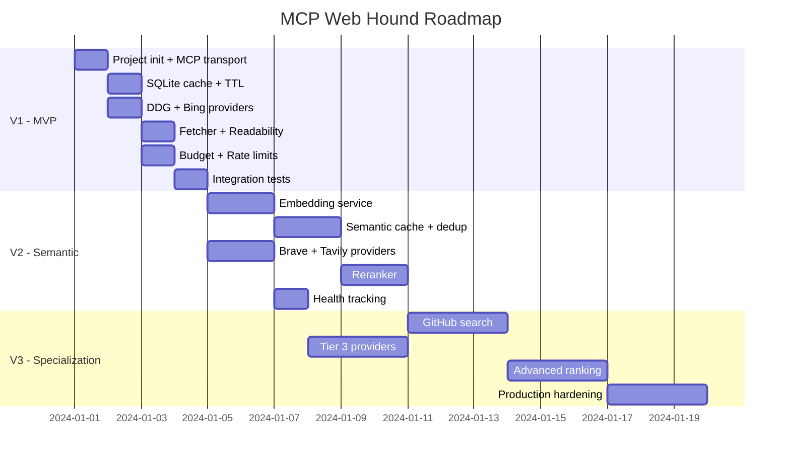

# Roadmap

## V1 — MVP (1–2 days)

Minimally working version with one provider and basic cache.

### Tasks

- [x] Project init (TypeScript, `@modelcontextprotocol/sdk`)
- [x] MCP transport (stdio, JSON-RPC)
- [x] Tool: `search` with zod validation
- [x] Tool: `status` with basic diagnostics
- [x] Query Normalizer (lowercase, trim, cache key)
- [x] SQLite cache (queries, results, pages)
- [x] TTL-based eviction
- [x] DuckDuckGo adapter (HTML scraping)
- [x] Sequential fallback (DDG → Bing)
- [x] Content Fetcher (HTTP GET → readability → markdown)
- [x] Budget Manager (search limit, fetch limit)
- [x] Rate limiting (per-provider)
- [x] Structured logging
- [x] `.env` configuration
- [x] Tests: unit for each module
- [x] Tests: integration smoke test

### V1 Result

Agent calls `web_search()` → first healthy provider responds → results cached.

---

## V2 — Semantic Layer + Tier 2 (3–5 days)

Semantic cache and official API providers.

### Tasks

- [x] Embedding service (multilingual-e5-small)
- [x] sqlite-vec integration
- [x] Semantic query cache (find similar, threshold 0.92)
- [x] Query deduplication (buffer last 50 queries)
- [x] Provider: Brave Search API adapter
- [x] Provider: Tavily API adapter
- [x] Reranker: semantic similarity scoring
- [x] Reranker: domain quality scoring
- [x] Reranker: freshness scoring
- [x] Reranker: position blending
- [x] Weighted final score
- [x] Intent-independent reranking weights
- [x] Deduplication by URL
- [x] Provider health tracking
- [x] Provider health recovery (5-min retry)
- [x] Extended `status()` (provider health, cache stats)
- [x] Tests: semantic cache
- [x] Tests: reranker scoring

### V2 Result

Agent gets deduplicated, ranked results. Similar queries don't waste budget. 4 providers with fallback.

---

## V3 — Specialization + Production (1–2 weeks)

Specialized search modes and production-ready hardening.

### Tasks

- [x] GitHub-specific search (GitHub API, repos/code/issues/users)
- [x] GitLab-specific search (GitLab API, projects/issues/MRs/blobs)
- [x] Docs-specific search — covered by `intent: "docs"` + reranker, separate tool not needed
- [x] Intent routing via NLI zero-shot (DeBERTa-v3-xsmall, 4 labels, softmax)
- [x] NLI-based reranking (intent-independent: 0.9 NLI + 0.04 domain + 0.03 freshness + 0.03 position)
- [ ] Advanced ranking: learning-to-rank based on agent feedback
- [ ] Provider health scoring (composite: latency + error rate + quality)
- [x] Provider: Exa adapter
- [x] Provider: Firecrawl adapter
- [x] Parallel multi-provider queries
- [x] Result aggregation across multiple providers
- [x] Config-driven provider order, execution mode (parallel/sequential), pagination
- [x] Search timeout, cached TTL, max results after rerank
- [x] Browser User-Agent for fetch layer
- [x] robots.txt — not needed: not a crawler, budget limits already protect sites
- [x] Cache analytics — not needed: agent doesn't use cache internals, status tool covers basics
- [x] DB migration system
- [x] Graceful shutdown (finish in-flight, close DB)
- [ ] Optional vector index (for large cached query volumes)
- [x] Comprehensive test suite
- [ ] Performance benchmarks
- [ ] Docker image
- [x] Documentation: deployment guide (OpenCode)
- [x] CI workflow (Node 20/22, npm ci, build, test)
- [x] GitLab tool hidden when token absent

### V3 Result

Production-ready MCP Search Server with 6 providers, GitHub/GitLab search, config-driven provider order, parallel/sequential execution, per-provider pagination limits, and full test suite.

---

## V4 — Stability & Local Search (In Progress)

### Priority Tasks

- [ ] **More web providers** — increase the number of scraped/API providers for better stability and fallback coverage. Current scraping providers (Startpage, DDG, Brave Web, Bing) are all undocumented and fragile.
  - [ ] **Candidate: Marginalia** (`https://search.marginalia.nu/search?query=`) — independent index, no key, no captcha. Probed 2026-11-03: HTTP 200 with a parseable SERP in ~300 ms *while Startpage, DDG and Brave Web were all blocked/captcha'd from the same IP*. Scope it to **English (Latin-script) queries only** — its index is small-web/English and Cyrillic coverage is negligible, so the provider must opt out for non-Latin queries (reuse the script detection from `query-locale.ts`). Its official API returns 401 (gated), so HTML scraping is the only channel. Tier 2, after Brave Web.
  - [ ] **Verified not viable** (same probe, residential IP): Mojeek `403` (and no public API endpoint), Qwant API `403`, Ecosia `403` captcha, public SearXNG instances (`priv.au` 429, `search.inetol.net` "Security check", `searx.be`/`searxng.online` unreachable — `format=json` is disabled on public instances by design), Reddit JSON `403`, OpenAlex `429` even with `mailto`, GDELT `429`/timeout, Common Crawl index `504`, PyPI Cloudflare challenge, Google and Startpage HTML (JS shell, no server-rendered results). A self-hosted SearXNG keeps the same exit IP, so it does not remove the captcha problem — only a clean IP would.
  - [ ] **Candidate: Stack Exchange** (`https://api.stackexchange.com/2.3/search/advanced`) — documented, versioned public API, no key required for read access. Probed 2026-11-03: HTTP 200 with 30 items for a `code`-flavoured query, and unlike the scraped engines it never returns a captcha page. Integration notes:
    - Quota (measured live 2026-11-03): without a key the wrapper reports **`quota_max: 300`, `quota_remaining` 298 → 297** — an anonymous **shared per-IP daily quota of 300**, shared with every other app on this IP. A registered app `key` lifts the documented daily limit to 10,000. The wrapper also carries `quota_max` / `quota_remaining` and a per-method `backoff` field, so the provider can back off from its own counters instead of waiting for a 40x — cleaner than the heuristic rate limiting the scraped engines need.
    - Params: `site=` (stackoverflow, plus superuser / askubuntu / serverfault / stackexchange for non-code questions), `order=desc&sort=relevance`, `q=`, and `filter=withbody` to get text usable as `ProviderResult.snippet`. Without `filter` the body is stripped and the results are useless for reranking.
    - Scope it to the `code` intent (the classifier already labels such queries) and treat it as a *complement*, not a general-web fallback: it only answers questions asked on Stack Exchange sites. English-only, same as Marginalia.
    - Needs its own limits (`STACKEXCHANGE_RPD` ≈ 280 to stay under the anonymous 300/day ceiling, or ≈ 9,000 with a key) and an optional `STACKEXCHANGE_KEY`; a key is an env-only change, no code.
    - Their first-party MCP server (`mcp.stackoverflow.com` via `mcp-remote`, tools `so_search` + `get_content`) is **not** a shortcut for us: it requires an interactive Stack Exchange login and is capped at 100 calls/day per user, which does not fit a headless server. Use the REST endpoint above instead.
  - [ ] **Candidate: other key-free vertical APIs** (all answered 200 with real data on the same probe, and the intent classifier already knows which queries they fit): Wikipedia `action=query&list=search` (note: `rest.php/v1/search` returned 500 — use the action API), Wikidata `wbsearchentities`, HN Algolia, Crossref, arXiv Atom, npm registry `/v1/search`. Cheaper and far more stable than scraping, but they answer verticals, not the open web.
- [ ] **Re-check provider pricing and limits** — Brave dropped its free Search API tier in Feb 2026: prepaid credits, **$5 per 1,000 requests**, with **$5 of free credits every month** (≈1,000 requests) and 50 QPS. Our docs and the `BRAVE_API_KEY` help text still say "2000 queries/month free", and `BRAVE_RPMONTH=2000` now exceeds the free allowance — it should match the credit budget. Context: Bing Search API is retired and Google Custom Search JSON API closes Jan 1, 2027, so scraped Bing (HTTP or browser channel) stays the only Bing path.
- [ ] **Stability backlog (measured 2026-11-03, deferred by decision — revisit before the next release).** Evidence came from a per-provider run of `startpage,ddg,brave_web,bing,brave_api,tavily,exa,firecrawl` on one query plus a parallel-load check of four searches.
  - [ ] **S1 — stop benching providers for the wrong reasons.** `classifyError()` (`src/limits/rate-limit-store.ts:119`) routes *every* unrecognized message into `access_denied` — including `Brave API key not configured`, timeouts, DNS failures and parse errors — and `access_denied_ms` is `86_400_000` for Startpage and Bing, with `SUSPENSION_BACKOFF = [60s, 5m, 15m, 1h, 4h, 24h]`. One failing query suspended Startpage + DDG + Brave Web at the same time (measured 5–15 min in `data/rate-limits.json`), which is how the free tier collapses. Add distinct classes (`timeout`, `network_error`, `parse_error`, `config_error`) that do not suspend (or suspend for ~30 s), keep suspensions for captcha/429/403, and stop suspending on an empty-but-successful response (`provider-router.ts:126` and `:174`).
  - [ ] **S2 — Bing serves a degraded SERP that passes every structural check.** For an English technical query the http channel returned `q=` correct, HTTP 200 and `b_algo=10`, but the results were Chinese-language off-topic pages; the browser channel returned Russian off-topic results for the same query. Emptiness/captcha checks cannot see this, and the reranker is currently the only filter (at the cost of latency). Detect it structurally — compare the script/language of the `li.b_algo` titles against the query language from `query-locale.ts` and mark the attempt `offscript` instead of `usable`. No relevance scoring.
  - [ ] **S3 — timeout semantics and latency.** `SEARCH_TIMEOUT_MS` is the deadline of the *whole* fan-out (`src/search/orchestrator.ts:185-196`), but `FIELD_DEFS` and the docs describe it as a per-provider timeout. Observed end-to-end 18.7 s for one search: fan-out under 15 s plus NLI scoring *after* the race, on cold models, because `MODEL_IDLE_TIMEOUT_SEC=5` unloads the models between searches. Separate the fan-out deadline from the scoring budget, fix the wording, and reconsider the 5 s idle unload.
  - [ ] **S4 — the failure message lies.** `provider-router.ts:190` throws `No providers configured` when providers are configured but every one returned an empty result set; the sequential path throws `All sequential providers failed` when nothing actually failed. Report `All providers returned empty results` with the per-provider reasons.
  - [ ] **S5 — hot worker respawn.** Under four concurrent searches one request died with `Hot worker exited (code=0 signal=null)` instead of the worker being respawned and the request retried; with `MODEL_WORKER=true` and `MODEL_IDLE_TIMEOUT_SEC=5` an idle exit is normal and must not surface as a search error.
  - [ ] **S6 — re-probe suspended engines faster.** Startpage, DDG and Brave Web were all suspended simultaneously, leaving Bing (browser) plus the API providers to carry everything.
- [ ] **Local document search** — search over local document databases (vector-indexed docs, wikis, internal knowledge bases). User-provided content, no network required.
- [ ] **System prompt expansion** — extend `search-protocol.md` with site-specific search patterns.
- [ ] **Agent testing on specific sites** — validate that the agent correctly searches and extracts information from targeted domains (Stackoverflow, Reddit, etc).

### Tasks

- [ ] Provider: additional search engines — candidates are tracked under "More web providers" above (Google Custom Search JSON API is not one of them: it closes Jan 1, 2027 and is closed to new customers)
- [ ] Generalize the endpoint override: Tavily already honors `TAVILY_BASE_URL` (a proxy in front of the API, `/search` appended when absent). Exa, Firecrawl and the Brave API client sit behind the same kind of CDN edge and 403 the same way, so give each of them the same `*_BASE_URL` treatment instead of hard-coding the origin.
- [ ] Local document indexing (embedding → sqlite-vec)
- [ ] Local document search tool (`search_docs`)
- [ ] Scraped provider health monitoring dashboard

---

## Dependencies by Phase

## Tech Stack

| Category | Technology | Version |
|----------|-----------|---------|
| Runtime | Node.js | >= 20 |
| Language | TypeScript | >= 5.3 |
| MCP transport | hand-rolled minimal MCP over stdio (`src/mcp/`, zero deps) | — |
| Database | better-sqlite3 | 12.11.1 |
| Vector | sqlite-vec | 0.1.9 |
| Validation | manual (no zod) | — |
| HTML parsing | removed (no fetch layer since c83183f) | — |
| DOM | removed | — |
| Markdown | removed | — |
| Embeddings | @xenova/transformers | 2.17.2 |
| HTTP | undici (built-in fetch) | built-in |
| Config | dotenv | latest |
| Logging | pino | latest |
| Testing | vitest | latest |
